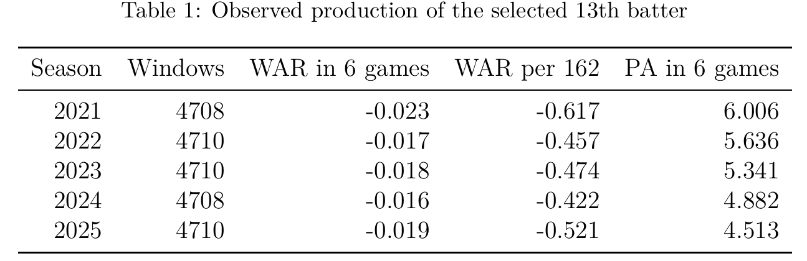

---
format:
  ufsal-revealjs:
    footer: "Feasibility of Using Major League Baseball 26-man Roster Spot on an Olympic-caliber Sprinter"
    width: 1600
    height: 900
    margin: 0.06
    center: false
    transition: fade
    css: cmsac.css
    title-slide: false
    slide-number: true
execute:
  echo: false
---

## {.uf-title background-image="ubiguity_gus.png" background-size="cover"}

{.uf-mark}

{.sal-mark}

::: {.title-block}
Feasibility of Using Major League Baseball 26-man Roster Spot on an Olympic-caliber Sprinter
:::

::: {.subtitle-block}
Can a "designated runner" successfully be employed in MLB?
:::

::: {.presenter-block}
Christian Farese, Dr. Scott Nestler
:::

## Introduction

Could an Olympic sprinter be worth more than the last position player on an MLB roster? There are 26 players on each MLB roster. 13 of them are pitchers and 13 are batters. The worst batter is considered more expendable than the worst pitcher. So we have to compare two possible choices:

- **Keep the 13th batter:** batting, fielding, and a deeper bench.
- **Carry a sprinter:** stolen bases, minus the cost of taking the original runner out. We assume that this sprinter cannot bat or field, so he cannot be reasonably allowed to play besides pinch running.

We compared those two uses of one roster spot over a season and came to a conclusion regarding which one was better. We used regular-season MLB data from 2021–2025. We wanted to include the extra-inning additional runner rule but also specifically excluded 2020 due to 7-inning doubleheaders.

## Selecting the 13th batter

- Due to the intense physical requirements of playing the catcher position, teams are practically required to roster at least two catchers at any given moment.
- During the season, teams usually play 6 games in a week. We checked every 6-game period in a season and found the least-used batter who was not one of the two players who fielded the most innings as a catcher. We then picked this player as our "13th batter" for that period.
- We rebuilt a rough estimate of Wins Above Replacement (WAR) by accounting for all runs created by a player (batting, baserunning, fielding, positional, etc.). We averaged it for all 13th batters.
- We could have assumed that the batter would have been a replacement-level player (or 0 WAR), but we felt that this was a more exact estimation of the hypothetical player who would be replaced.
- Comparing the performance of teams when they only had 12 batters to 13 batters, there was no significant difference in performance.

## What the 13th batter contributes {.figure-slide}

{.nostretch .paper-figure .paper-table}

In all four years, the 13th batter was below replacement level at -0.498 WAR per 162 games.

- We are not assuming that the 13th batter will play 162 games.
- We are saying that if the batter is on the roster for a 162-game season, they will be worth -0.498 WAR.

## Creating a safe rate for the Olympic-caliber sprinter (1/2)

To create a measure of value for the Olympic-caliber sprinter, we have to estimate how often they will successfully be able to steal second and third base.

- We selected a single sprinter to sample for this project, Oblique Seville. Seville finished 8th (out of 8) at the 2024 Paris Olympics 100m final heat.
- We compared Seville's time from that 100m heat to known sprint splits for MLB runners. After removing reaction time, Seville reached 90 feet in 3.46 seconds while the fastest MLB runner took 3.66 seconds and the MLB average was at 4.05 seconds.

## Running time along the basepath {.figure-slide}

{.nostretch .paper-figure}

## Creating a safe rate for the Olympic-caliber sprinter (2/2)

- We created a kinematic model to both correct for the sprinter's block start and for the fact that they have to slide instead of "running through the tape."
- We calculated how long it would take the sprinter to reach second base from first base and then used a logarithmic distribution to estimate what the sprinter's stolen base percentage would likely be.
- To estimate a catcher's pop time (time from receiving the ball to it reaching second base), we used J.T. Realmuto as a stand-in catcher and used his pop time mean and distribution. Realmuto averaged the quickest pop time of any catcher in MLB in 2025.
- We estimated that, on average, the sprinter will be safe by 0.295 seconds. Based on variance in stolen base rates for normal MLB players and by using the logarithmic distribution, we found that the sprinter would likely be safe 93.1% of the time.

## The problem with removing a runner

- Barring a star player having a rest day, a manager will usually start the nine players are best-suited for the day.
- By removing a player for the sprinter, we ensure that eventually the sprinter will be replaced with a batter from the bench, this will usually carry some negative run implication.
- We calculated this by simulating the run value lost by playing the bench player in the upcoming innings.
- The later we substitute the sprinter into the game, the lower the run value loss will be. The worse bench player will not have as many PAs or fielding opportunities to impact the game.

## The cost of replacing the original runner {.figure-slide}

{.nostretch .paper-figure}

The average loss in run value (across all states) from specifically the substitution is 0.043 runs.

## When do we actually use this sprinter?

Assuming we have a sprinter with a 93.1% safe rate on second-base attempts, when is the right time to deploy them?

- If we deploy the sprinter too early, we could be wasting the opportunity to deploy them in a higher-leverage moment.
- If we delay deploying the sprinter, we risk not actually being able to use them in a situation that matters.

We built a basic model to account for this. We compared win probability added on both successful and unsuccessful steals in every game state when there was a runner on first and second base was open. We then compared this to the odds of being able to use the runner in a future circumstance and what the team stood to gain in the moment.

## When to use the sprinter {.figure-slide}

{.nostretch .paper-figure .rule-table-image}

The model settled on a rule that looks like this.

## Can we do this with third base as well?

We repeated the same analysis for stealing third base.

- We found that the success rate was slightly lower at 92.2%. We still use J.T. Realmuto's pop time in our measurement, but for third base instead of second.
- We assumed that, whenever third base is available after a successful steal of second, the sprinter immediately tries to steal third base. If the sprinter is already playing, we know that this will always carry positive value for the team.
- Stealing third base is implicitly less valuable than stealing second base from a run value perspective; getting in scoring position is more important than going from second to third. This carries slightly less value for the sprinter, but still brings positive value.

## Is the 13th batter better or the sprinter?

What were our final results?

- We found the value of the 13th batter to be -0.498 WAR over a 162-game season.
- The sprinter has a value of 1.623 WAR over a 162-game season.
- The value of the Olympic-caliber sprinter outweighs that of a conventional 13th batter on an MLB roster.

In reality, the sprinter would probably be worth slightly more than their WAR suggests since many of their runs are coming in high-leverage situations.

## Case study: the 2025 Miami Marlins

We took a middle of the road 77-85 Marlins team and tried to apply the sprinter and the rule to them, just as a demonstration of what the team can expect from the player. There were 71 opportunities in the season to use the sprinter. We assigned +1 "point" to the runner whenever a loss became a win because of them. Whenever a loss became a tie, we assigned +0.5 "points". For instance, this would be a game the Marlins lost by one run but the sprint runner would have turned into an extra-innings affair. The same applied in the negative direction.

| Simulated change | Per season |
|---|---:|
| Loss becomes a win | 1.34 |
| Loss becomes a tie | 5.05 |
| Win becomes a tie | 0.77 |
| Win becomes a loss | 0.40 |

Over 400,000 simulated seasons, the team's record improved 98.3% of the time. The average gain was 3.07 points, counting a win as 1 and a tie as 0.5. We can roughly translate this to an additional 3 average wins for the team.

## The Oakland A's in the 60's and 70's

We are not the first people to think of this premise. Charles Finley, the owner of the Oakland A's, also came up with the basic idea of a designated runner and field-tested it from 1967 to 1978 in the major leagues. The idea didn't succeed in part because these designated runners had very poor baserunning instinct. Our presentation of this idea carries three relevant differences:

- We selected Oblique Seville, who was the 8th fastest man in the world at the 100-meter dash. Although the A's used track and field athletes, none of them are particularly as fast as Seville.
- We are assuming that our hypothetical baserunner will have average baserunning instincts. This is a stretch compared to what the A's actually experienced, but it is not an unreasonable one. In the modern-day, given specialized baserunning coaches and training, one could logically assume a sprinter could learn enough baserunning instinct to be a positive-value contributor to the team.
- The A's did not use their designated runner as optimally as they could have. They used them whenever they felt it was necessary instead of sticking to strict statistics, which hurt the final run value of the designated runner.

Baseball is a circular sport, where old discarded ideas often become a good way to find value again. It's rational to assume this could be one of those ideas.

## Limitations

- We assume that the player will have a reasonable amount of baserunning ability (not speed, baserunning).
- We are only including a steal of second and a steal of third. We are not including additional ways to earn baserunning value, such as going first-to-third or second-to-home on a single.
- There is not enough accurate medical data to properly quantify the effect a loss in rest could have from moving to a 13-batter to a 12-batter roster.
- Roster expansion in September and October could reasonably increase the value of the strategy, but there is a relatively low sample size for specifically these months to give an exact estimated gain.
- We assume that the sprinter has had time to prepare physically for pinch-running and will not come in "cold." We were not able to realistically model the difference between running on asphalt and dirt for the simulation.
- Replacing a runner also reduces the manager’s bench options. The bench is essentially reduced to two batters instead of the traditional four, since one spot has to be saved for whoever is coming in after the sprinter.
- We cannot be sure how teams will react with pickoffs/pitchouts. Naturally, pitchouts would see an uptick with the sprinter on-base. However, pitchouts have recently been mostly abandoned due to their inherent negative value. Teams will have to "pick their battles" between trying to eliminate the sprinter or the active batter.

## Conclusion

We determine that it is feasible to use a 26-man roster spot on an Olympic-caliber sprinter. We estimate a total gain of 2.121 WAR over the standard 13th batter, comparing a situation where either the sprinter or batter is on the roster for the entire season.

## References

- MLB Stats API and baseballr: active rosters and schedules.
- Baseball Savant: running splits, catcher throws, and game data.
- Paris 2024 and World Athletics: Seville’s times and reaction time.
- FanGraphs: WAR and stolen-base run values.
- Bukiet, Harold, and Palacios (1997): base-out Markov models.

Full citations are in the paper and its bibliography.