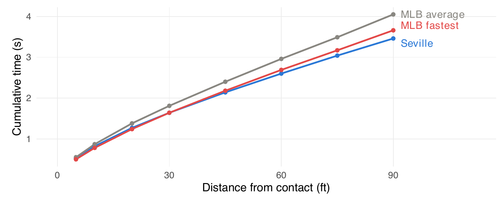
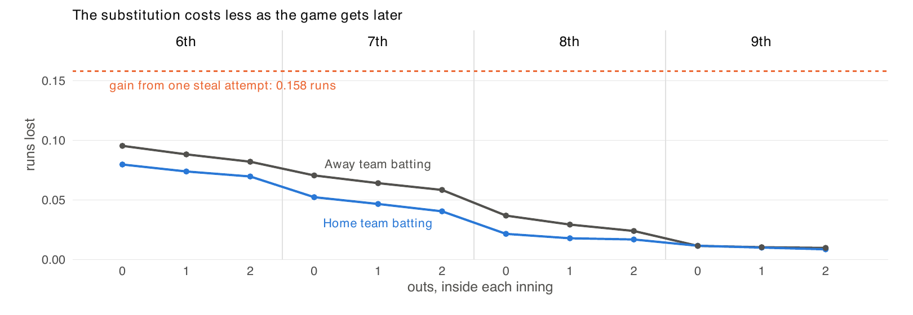
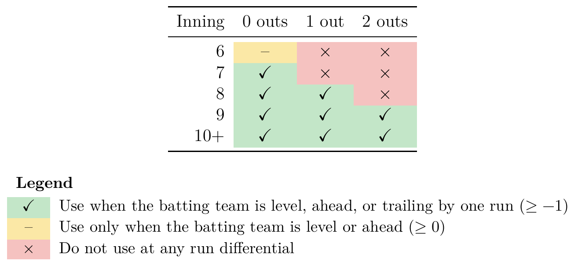

---
format:
  ufsal-revealjs:
    footer: "Speed over depth: Evaluating an Olympic-caliber sprinter’s value on an MLB roster"
    width: 1600
    height: 900
    margin: 0.06
    center: false
    transition: fade
    css: cmsac.css
    title-slide: false
    slide-number: true
execute:
  echo: false
---

## {.uf-title background-image="ubiguity_gus.png" background-size="cover"}

{.uf-mark}

{.sal-mark}

::: {.title-block}
Speed over depth: Evaluating an Olympic-caliber sprinter’s value on an MLB roster
:::

::: {.subtitle-block}
Can a "designated runner" successfully be employed in MLB?
:::

::: {.presenter-block}
Christian Farese, Dr. Scott Nestler
:::

::: {.notes}
Today, we ask whether an Olympic-caliber sprinter could provide more value on an MLB roster than the final bench position player.

The central tradeoff is speed versus depth: can a specialist runner’s baserunning gains outweigh the hitting, fielding, and flexibility the team gives up?

We’ll walk through how we modeled that decision and what our results suggest.

This work was guided by Dr. Scott Nestler, Director of the UF Sports Analytics Lab.
:::

## Could an Olympic sprinter be worth an MLB roster spot?

- **The choice:** A final (13th) bench position player or a specialist pinch runner?
- Bench player: hitting, fielding, and roster depth
- Sprinter: stolen-base potential—but no hitting or fielding
- Our analysis: Compare their value over a season using 2021–2025 MLB data

::: {.notes}
Could a sprinter outperform the final position player on an MLB roster? We assume 13 pitchers and 13 position players, replacing a position player—not a pitcher.
The bench player provides hitting, fielding, and depth. The sprinter contributes only as a pinch runner, and using him removes the original player for the rest of the game. We must weigh stolen-base gains against those lost contributions.
We compare these roster choices over a full season using 2021–2025 regular-season data. This includes the extra-inning automatic-runner rule but excludes 2020 and its seven-inning doubleheaders.
:::

## Selecting the 13th batter

- **Identify:** Find the least-used position player in each six-game window
- Exclude the two primary catchers
- Estimate the selected players’ value using reconstructed WAR
- Compare team performance with 12 versus 13 position players

::: {.notes}
We examined every six-game window, approximating a week while allowing the selected player to change during the season.
We protected the two players with the most catching innings, then selected the least-used remaining position player as the “13th batter.”
We reconstructed approximate Wins Above Replacement, or WAR, using batting, baserunning, fielding, positional adjustments, and other run-value components. Averaging across selected players estimates the roster spot’s value from actual usage, rather than assuming zero WAR.
Separately, we found no statistically significant performance difference between teams carrying 12 versus 13 position players. That does not prove bench depth has no value.
:::

## What the 13th batter contributes {.figure-slide}

Observed production of the selected 13th hitter:

| Season | Windows | WAR in 6 games | WAR per 162 | PA in 6 games |
|---|---|---|---|---:|
| 2021 | 4708 | -0.023 | -0.617 | 6.006 |
| 2022 | 4710 | -0.017 | -0.457 | 5.636 |
| 2023 | 4710 | -0.018 | -0.474 | 5.341 |
| 2024 | 4708 | -0.016 | -0.422 | 4.882 |
| 2025 | 4710 | -0.019 | -0.521 | 4.513 |

In all five years, the 13th batter was below replacement level at -0.498 WAR per 162 games.

- We are not assuming that the 13th batter will play 162 games.
- We are saying that if the batter is on the roster for a 162-game season, they will be worth -0.498 WAR.

::: {.notes}
Across all five seasons, the selected 13th hitter averaged roughly five to six plate appearances per six-game window and had negative estimated WAR. Annualized, that’s about half a win below replacement. This describes the roster spot’s contribution over a full season—not one player appearing in all 162 games—and provides our baseline for evaluating the sprinter.
:::

## Estimating the sprinter’s stolen-base success rate (1/2)

- **Benchmark:** Oblique Seville’s 2024 Olympic 100-meter final
- Compare his estimated 90-foot time with MLB sprint splits
- Exclude reaction time from the comparison

| Runner | Time to 90 feet |
|---|---:|
| Oblique Seville | 3.46 seconds |
| Fastest MLB runner | 3.66 seconds |
| MLB average | 4.05 seconds |

::: {.notes}
Our speed benchmark is Oblique Seville’s performance in the 2024 Paris Olympic 100-meter final, where he finished eighth.
Excluding reaction time, his estimated 90-foot time was 3.46 seconds, versus 3.66 for the fastest MLB runner and 4.05 for the MLB average.
These times establish a speed advantage, not a stolen-base success rate. To estimate his chances of stealing second and third, we still need to account for baseball-specific movement and the time available before the throw arrives.
:::

## Seville’s speed advantage grows over 90 feet {.figure-slide}

{.nostretch .paper-figure}

::: {.notes}
The figure shows cumulative time by distance; lower lines mean faster times. Seville’s early splits resemble the fastest MLB runner’s, but his advantage grows later in the sprint.
At 90 feet, he is an estimated 0.20 seconds ahead of the fastest MLB runner and 0.59 seconds ahead of the average, after removing reaction time.
That widening gap matters because top speed alone does not describe a short baserunning sprint. Next, we adjust these timings for a baseball start and a slide, then compare arrival with the catcher’s throw.
:::

## Estimating the sprinter’s stolen-base success rate (2/2)

- Adjust sprint timing for a baseball start and a slide
- Model catcher throws using J.T. Realmuto’s pop-time distribution
- Estimated arrival margin: 0.295 seconds ahead of the throw
- Predicted stolen-base success rate: **93.1%**

::: {.notes}
Our motion model adjusts track speed for starting without blocks and sliding into second.
We use J.T. Realmuto’s pop-time distribution because he had MLB’s quickest average in 2025. Pop time runs from the catcher receiving the pitch to the ball reaching second.
The sprinter arrives an estimated 0.295 seconds before the throw, on average. Using a logarithmic distribution incorporating variability in MLB stolen-base success rates, we estimate a 93.1% chance of being safe.
That is a model prediction—not an observed success rate for Seville playing baseball.
:::

## The cost of replacing the original runner

- Pinch running removes the original player from the game
- A bench player then takes over hitting and fielding duties
- We simulate the expected run value lost over the remaining innings
- **Timing:** Later substitutions leave fewer opportunities for that loss to accumulate

::: {.notes}
Using the sprinter removes the original runner. A bench player must then handle hitting and fielding because the sprinter cannot meaningfully contribute in either role.
We assume the starting lineup generally contains the best players for that day, with exceptions such as rest days. Replacing one therefore usually reduces expected production.
We simulate the run value lost over the remaining innings. Earlier substitutions leave more plate appearances and fielding opportunities for that cost to accumulate; later substitutions leave fewer.
The relevant comparison is the sprinter’s baserunning gain minus this replacement cost.
:::

## The cost of replacing the original runner {.figure-slide}

{.nostretch .paper-figure}

The average loss in run value (across all states) from specifically the substitution is 0.043 runs.

::: {.notes}
This graph shows replacement cost by inning and outs: gray for the away team, blue for home. Both decline as fewer opportunities remain for the replacement player to affect the game.

The average cost is 0.043 runs across modeled states. The dashed orange line shows an expected gain of 0.158 runs per steal attempt, exceeding the substitution cost throughout the situations shown.

Later deployment reduces that cost, but this graph does not settle when to act. We must also consider whether a better opportunity might arise later.
:::

## When should we deploy the sprinter?

- Assume a 93.1% success rate when stealing second
- Use now: Capture an immediate win-probability gain
- Wait: Preserve the sprinter for a potentially higher-leverage opportunity
- **Decision:** Compare the expected value of acting now versus waiting

::: {.notes}
Even at 93.1% success, timing matters. Acting early sacrifices later opportunities; waiting risks never using the sprinter.
For states with a runner on first and second open, our decision model weights the win-probability changes from a successful steal and a caught stealing by their estimated probabilities.
It compares that immediate expected gain with the value of waiting, accounting for both the chance of another eligible opportunity and its potential benefit.
We are not just asking whether a steal helps now, but whether it helps enough to give up the option of waiting.
:::

## When to use the sprinter {.figure-slide}

{.nostretch .paper-figure .rule-table-image}

Deploy earlier with fewer outs; broaden use as the game gets later.

::: {.notes}
With a runner on first and second open, green means deploy when tied, ahead, or down one; yellow means only tied or ahead; red means wait.

In the sixth, use the sprinter only with no outs and tied or ahead. In the seventh, include trailing by one, still with no outs. In the eighth, include one out. From the ninth onward, use him with any number of outs when no more than one run behind.

The rule broadens late because fewer future opportunities remain. Earlier, it is worth being more selective.
:::

## Can we do this with third base as well?

- Estimated success rate: **92.2%**
- Extend the model using Realmuto’s pop times to third
- After stealing second, attempt third whenever it is open
- Smaller incremental run-value gain—but still positive in our model

::: {.notes}
Repeating the analysis with Realmuto’s pop times to third gives a 92.2% success estimate, versus 93.1% for second.
Our strategy attempts third immediately after stealing second whenever third is open. Since the sprinter has already entered, there is no additional cost of removing the original player—only the tradeoff between advancing and being caught.
The attempt adds positive expected value in our model, but less than stealing second. Reaching second puts the runner in scoring position; reaching third adds a smaller run-value benefit.
:::

## The sprinter provides more value in our model

| Roster option | Estimated WAR per 162 games |
|---|--:|
|13th position player | −0.498 |
| Olympic-caliber sprinter | 1.623 |

Advantage: 2.121 WAR for the sprinter over a full season

::: {.notes}
Over 162 games, we estimate −0.498 WAR for the 13th position player and 1.623 for the sprinter: a 2.121-WAR advantage.
This compares two full-season uses of a roster spot under our assumed success rates, deployment strategy, and replacement costs—not observed results from a team carrying an Olympic sprinter.
Because deployment targets valuable game situations, we also ask how the contribution might translate into wins. Any additional high-leverage benefit needs separate quantification; we should not simply add it to the WAR estimate. The next case study explores team outcomes.
:::

## Case study: Adding a sprinter to the 2025 Marlins

- 71 deployment opportunities across the season
- Improved outcomes in 98.3% of 400,000 simulated seasons

| Simulated change | Per season |
|---|---:|
| Loss becomes a win | 1.34 |
| Loss becomes a tie | 5.05 |
| Win becomes a tie | 0.77 |
| Win becomes a loss | 0.40 |

Average gain: **3.07 win-equivalent points per season**

::: {.notes}
For the 2025 Marlins, who finished 77–85, our rule identified 71 deployment opportunities. We simulated their season 400,000 times; the table reports average shifts among losses, ties, and wins.

A loss becoming a win earns one point; a loss becoming a tie earns half a point. Reverse changes receive corresponding penalties.

A tie is intermediate, not a final MLB result: an extra run might force extra innings without guaranteeing a win.

The outcome score improved in 98.3% of simulations, averaging 3.07 additional points. That is roughly three win-equivalents, not three guaranteed wins. This illustrates potential under our assumptions, rather than predicting exactly how Miami’s record would change.
:::

## Revisiting the A’s designated-runner experiment

- Charles Finley’s A’s tested specialist pinch runners decades ago
- Our model revisits the idea with three differences:
    - Speed: An Olympic-finalist benchmark
    - Skills: An assumption of average baserunning instincts
    - Strategy: Model-guided deployment
- Could a different approach make an old idea viable?

::: {.notes}
Charles Finley’s A’s tried designated runners in the 1960s and 1970s. We revisit that idea with three distinctions.
First, Seville’s Olympic-final performance defines our speed benchmark; it does not establish that he was faster than every A’s specialist.
Second, we assume average baserunning instincts. That ability is not demonstrated: a sprinter would need baseball-specific training, and whether he could reach the required proficiency remains an open question.
Third, our decision model weighs immediate value against future opportunities. We have not quantified an improvement over the A’s historical deployment.
The earlier experiment does not settle whether a different approach could work. Our results support reconsidering the strategy under the assumptions tested.
:::

## Limitations and unmodeled effects

- **Readiness:** Assume adequate baserunning skills and physical preparation
- Scope: Model steals of second and third, not other advancement
- Roster costs: Incompletely capture rest needs and bench flexibility
- Uncertainty: Surface effects, expanded rosters, and defensive responses

::: {.notes}
Several limitations could move our estimate in either direction.
We assume adequate baseball-specific skills and physical preparation before deployment. We did not model surface differences, including track versus infield dirt.
We count steals of second and third, but not other advancement, such as scoring from second on a single. Those omitted opportunities could add value.
On the cost side, fewer position players could limit rest and affect fatigue, injuries, or performance; we lacked medical data to quantify these effects. Another bench player must also remain available to replace the sprinter. Our replacement-cost estimate does not fully capture that lost flexibility.
Expanded rosters might ease these constraints, but our September and October samples were too small for precise estimates.
Finally, opponents could adjust through pickoffs, pitchouts, or other tactics, affecting success rates and creating defensive tradeoffs. We did not fully model those responses.
Elite speed alone therefore does not guarantee our estimated benefit: readiness, roster constraints, and defensive adjustments remain important uncertainties.
:::

## An Olympic-caliber sprinter could justify a roster spot

- Estimated full-season advantage: 2.121 WAR over the 13th position player
- Supports the strategy’s feasibility under our modeled assumptions

::: {.notes}
An Olympic-caliber sprinter could justify a roster spot: our model estimates a 2.121-WAR advantage over the conventional 13th position player when each occupies that spot for a full season.
That result depends on stolen-base success, baseball-specific skills, deployment timing, and replacement costs. It supports the strategy’s potential—not a guarantee of the same gain in practice.
:::

## References

- MLB Stats API and baseballr: active rosters and schedules.
- Baseball Savant: running splits, catcher throws, and game data.
- Paris 2024 and World Athletics: Seville’s times and reaction time.
- FanGraphs: WAR and stolen-base run values.
- Bukiet, Harold, and Palacios (1997): base-out Markov models.

Full citations are in the paper and its bibliography.

::: {.notes}
Our sources cover MLB rosters, game data, and Olympic sprint times. FanGraphs informed value estimates; Bukiet, Harold, and Palacios underlie the base-out model. The slide lists the sources, with full citations in the paper.
:::
