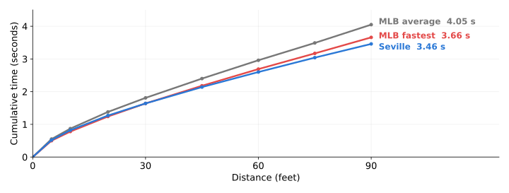
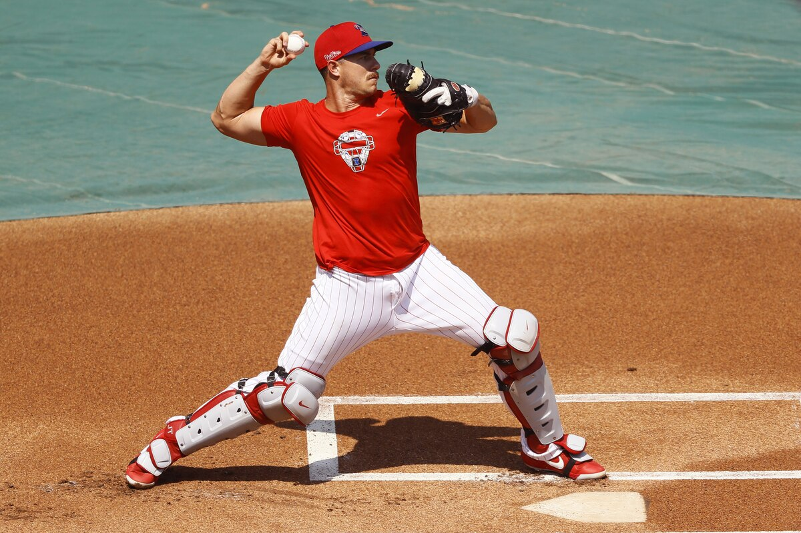
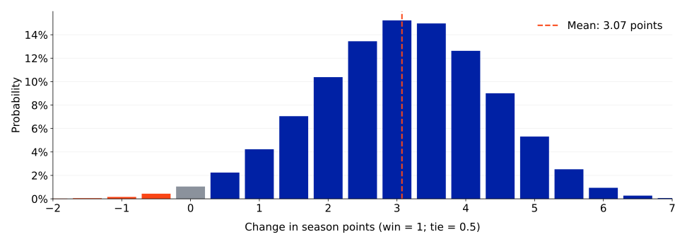
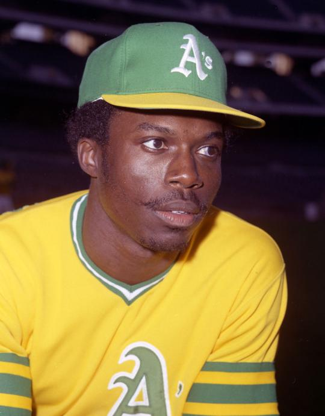

---
format:
  ufsal-revealjs:
    footer: "Speed over depth: Evaluating an Olympic-caliber sprinter’s value on an MLB roster"
    width: 1600
    height: 900
    margin: 0.06
    center: false
    transition: fade
    css: cmsac.css
    title-slide: false
    slide-number: true
execute:
  echo: false
---

## {.uf-title background-image="ubiguity_gus.png" background-size="cover"}

{.uf-mark}

{.sal-mark}

::: {.title-block}
Speed over depth: Evaluating an Olympic-caliber sprinter’s value on an MLB roster
:::

::: {.subtitle-block}
Can a "designated runner" successfully be employed in MLB?
:::

::: {.presenter-block}
Christian Farese, Dr. Scott Nestler
:::

::: {.notes}
Today, we ask whether an Olympic-caliber sprinter could provide more value on an MLB roster than the final bench position player.

The main tradeoff is speed versus depth: can a specialist runner’s baserunning outweigh the hitting, fielding, and flexibility the team gives up?

I’ll walk through how we modeled that decision and what our results suggest.

This work was guided by Dr. Scott Nestler, Director of the UF Sports Analytics Lab.
:::

## Could an Olympic sprinter be worth an MLB roster spot?

- **The choice:** Roster a final (13th) bench position player or a specialist pinch runner?
- 13th batter: hitting, fielding, and roster depth
- Sprinter: stolen-base potential—but no hitting or fielding
- Our analysis: Compare each of their run values over a season using 2021–2025 MLB data
- The Oakland A's tried this experiment in the late 60's and early 70's to limited success, but we are assuming better runners, a more optimized usage strategy, and average baserunning instincts

::: {.notes}
Could a sprinter outperform the final position player on an MLB roster? MLB rosters have 26 players on the roster, split into 13 pitchers and 13 position players. Since pitchers have traditionally been rostered over hitters when the opportunity arrises, we examined removing the 13th position player (batter).

The bench player provides hitting, fielding, and depth. The sprinter contributes only as a pinch runner, and using him removes the original player for the rest of the game. We assume that he cannot bat or field at all. We have to weigh stolen-base gains against those lost contributions.

We compare these roster choices over a full season using 2021–2025 regular-season data. This includes the extra-inning automatic-runner rule but excludes 2020 and its seven-inning doubleheaders.

The Oakland A's also gave this a try a while back, and their experiment of using designated runners wasn't as successful as it could've been. While their runners did lack fundamental baserunning instincts, they also did not select the fastest sprinters and did not use these players as optimally as they could have.
:::

## Selecting the 13th batter

- Find the least-used position player in each six-game window
- Exclude the two primary catchers
- Estimate the selected players’ value using reconstructed WAR
- Compare team performance with 12 versus 13 position players
- The 13th batter averaged -0.498 WAR per season

::: {.notes}
We examined every six-game window, approximating a week while allowing the selected player to change during the season.

Due to the physical stress of playing the catcher position, teams are usually forced to roster two of them over the course of a season. We protected the two players with the most catching innings, then selected the least-used remaining position player as the “13th batter.”

We reconstructed approximate Wins Above Replacement, or WAR, using batting, baserunning, fielding, positional adjustments, and other run-value components. Averaging across selected players estimates the roster spot’s value from actual usage, rather than assuming zero WAR.

We also compared teams when they had 12 versus 13 position players. We found no statistically significant performance difference between those teams. That does not prove bench depth has no value, but it does mean that carrying the 13th batter might not be as significant as one might think.

Over the course of a full season, the 13th batter averaged roughly a half win below replacement level.
:::

## Estimating the sprinter’s stolen-base success rate (1/2) {.photo-slide .combined-splits-slide}

:::: {.photo-layout}
::: {.photo-copy}
- Benchmark: Oblique Seville’s 2024 Olympic 100-meter final
- Compare his estimated 90-foot time with MLB sprint splits
- Excluded reaction time from the comparison conservatively

{.nostretch .inline-splits-chart}

:::
::: {.photo-side}

{.nostretch .athlete-photo}

::: {.photo-credit}
Oblique Seville at the Paris Olympics, 3 August 2024.

Photo: [Aeltegop](https://commons.wikimedia.org/wiki/User:Aeltegop) / [Wikimedia Commons](https://commons.wikimedia.org/wiki/File:Oblique_Seville_03.08.2024.jpg), [CC BY 4.0](https://creativecommons.org/licenses/by/4.0/). Uncropped.
:::
:::
::::

::: {.notes}
We selected one sprinter to use as a benchmark, Oblique Seville. Seville finished eighth at the 2024 Paris Olympics 100-meter final. Excluding reaction time, his estimated 90-foot time was 3.46 seconds, versus 3.66 for the fastest MLB runner and 4.05 for the MLB average.

The figure shows cumulative time by distance; lower lines mean faster times. We were somewhat conservative removing the sprinter's reaction time to avoid allowing his block start to give him an advantage.
:::

## Estimating the sprinter’s stolen-base success rate (2/2) {.photo-slide .realmuto-slide}

:::: {.photo-layout}
::: {.photo-copy}
- Adjust sprint timing for a baseball start and a slide
- Model catcher throws using J.T. Realmuto’s pop-time distribution
- Estimated arrival margin: 0.295 seconds ahead of the throw
- Predicted stolen-base success rate: **93.1%**
:::
::: {.photo-side}

{.nostretch .athlete-photo}

::: {.photo-credit}
J.T. Realmuto throwing to second during practice, 6 July 2020.

Photo: Matt Slocum / Associated Press. [Source: Bleacher Report](https://bleacherreport.com/articles/2912284-2020-mlb-free-agents-rumors-predictions-for-jt-realmuto-trevor-bauer-more).
:::
:::
::::

::: {.notes}
Our motion model adjusts track speed for starting without blocks and sliding into second.

We used J.T. Realmuto’s pop-time distribution because he had MLB’s quickest average in 2025. Pop time runs from the catcher receiving the pitch to the ball reaching second.

The sprinter arrives an estimated 0.295 seconds before the throw, on average. Using a logarithmic distribution incorporating variability in MLB stolen-base success rates, we estimate a 93.1% chance of being safe.
:::

## The cost of replacing the original runner {.figure-slide}

{.nostretch .paper-figure}

The average loss in run value (across all states) from specifically the substitution is 0.043 runs.

::: {.notes}
Using the sprinter removes the original runner. A bench player must then handle hitting and fielding because the sprinter cannot meaningfully contribute in either role.

We assume the starting lineup generally contains the best players, with exceptions such as rest days. Replacing a player therefore usually reduces expected production.

This graph shows replacement cost by inning and outs: gray for the away team, blue for home. Both decline as fewer opportunities remain for the replacement player to affect the game.

The average cost is 0.043 runs across modeled states. The dashed orange line shows an expected gain of 0.158 runs per steal attempt, exceeding the substitution cost throughout the situations shown.

Later deployment reduces that cost, but this graph does not settle when to act. We must also consider whether a better opportunity might arise later.
:::

## When to use the sprinter {.figure-slide}

{.nostretch .paper-figure .rule-table-image}

With an assumed 93.1% stolen base success rate, stealing second base.

::: {.notes}
Even at 93.1% success, timing matters. Acting early sacrifices later opportunities; if we wait, we risk never using the sprinter.

For states with a runner on first with second base open, our decision model weights the win-probability changes from a successful steal and a caught stealing by their estimated probabilities.

The rule broadens late because fewer opportunities to use the sprinter remain. Earlier, it is worth being more selective.
:::

## We can also replicate this analysis with third base

- Estimated success rate: **92.2%**
- Extend the model using Realmuto’s pop times to third
- After stealing second, attempt third whenever it is open
- Smaller incremental run-value gain—but still positive in our model

::: {.notes}
Repeating the analysis with Realmuto’s pop times to third gives a 92.2% success estimate, versus 93.1% for second.

Our strategy attempts third immediately after stealing second whenever third is open. Since the sprinter has already entered, there is no additional cost of removing the original player—only the tradeoff between advancing and being caught.
:::

## Case study: Adding a sprinter to the 2025 Marlins {.marlins-layout-slide}

- 71 deployment opportunities across the season
- Improved outcomes in 98.3% of 400,000 simulated seasons

:::: {.marlins-layout}
::: {.marlins-table}

| Simulated change | Per season |
|---|---:|
| Loss becomes a win | 1.34 |
| Loss becomes a tie | 5.05 |
| Win becomes a tie | 0.77 |
| Win becomes a loss | 0.40 |

:::
::: {.marlins-chart}

{.nostretch}

:::
::::

Average gain: **3.07 win-equivalent points per season**

::: {.notes}
Here, we did a case study with the 2025 Miami Marlins. We completed a Monte-Carlo simulation deploying our sprinter. Whenever the sprinter turned a loss into a tie, we added half a point. Whenever they turned a loss into a win, we added a full point. Whenever the opposite would happen, we would deduct points. This is to give roughly an idea of how many additional wins a team might expect with the sprinter.

The outcome score improved in 98.3% of simulations, averaging roughly 3 additional points. That is roughly three win-equivalents, not three guaranteed wins. This illustrates potential under our assumptions, rather than predicting exactly how Miami’s record would change.

Something interesting to consider is that teams closer to .500 who experience more close games might use the sprinter more than a team who wins or loses more games by larger margins.
:::

## Limitations and unmodeled effects

- Readiness: Assume adequate baserunning skills and physical preparation
- Scope: Model steals of second and third, not other advancement
- Roster costs: Incompletely capture rest needs and bench flexibility
- Defensive strategies: More pickoff attempts or the reintroduction of pitchouts

::: {.notes}
Several limitations could move our estimate in either direction.

We assume adequate baseball-specific skills and physical preparation before deployment. We did not model surface differences, including track versus infield dirt.

We also count steals of second and third, but not other advancement, such as scoring from second on a single. Those omitted opportunities could add value to the sprinter.

On the cost side, fewer position players could limit rest and affect fatigue, injuries, or performance; we lacked medical data to quantify these effects. Another bench player must also remain available to replace the sprinter. Our replacement-cost estimate does not fully capture that lost flexibility. MLB expands the rosters from 26 players to 28 players in September and October; these might ease these constraints, but the samples were too small for precise estimates.

Finally, opponents could adjust through pickoffs, pitchouts, or other tactics, affecting success rates and creating defensive tradeoffs. We lack the available data those responses. For example, pitchouts have been mostly abandoned since the adoption of sabermetrics due to their perceived negative value. It would be an individual team decision as to whether to bring back pitchouts.
:::

## An Olympic-caliber sprinter could justify a roster spot

- Estimated full-season advantage: 2.121 WAR over the 13th position player
- Supports the strategy’s feasibility under our modeled assumptions

::: {.notes}
An Olympic-caliber sprinter could justify a roster spot: our model estimates a 2.121-WAR advantage over the conventional 13th batter when each occupies that spot for a full season. Under our assumptions, we find the designated runner feasible to use.
:::

## References

- MLB Stats API and baseballr: active rosters and schedules.
- Baseball Savant: running splits, catcher throws, and game data.
- Paris 2024 and World Athletics: Seville’s times and reaction time.
- FanGraphs: WAR and stolen-base run values.
- Bukiet, Harold, and Palacios (1997): base-out Markov models.

Full citations are in the paper and its bibliography.

::: {.notes}
These are our sources.
:::

## Thank you for listening

Any questions?

::: {.notes}
Thank you so much for listening. Does anybody have any questions?
:::

## Revisiting the A’s designated-runner experiment {.photo-slide}

:::: {.photo-layout}
::: {.photo-copy}
- Charles Finley’s A’s tested specialist "designated runners" decades ago
- Our model revisits the idea with three differences:
    - Speed: An Olympic-finalist benchmark
    - Skills: An assumption of average baserunning instincts
    - Strategy: Model-guided deployment
- Could a different approach make an old idea viable?
:::
::: {.photo-side}

{.nostretch .athlete-photo}

::: {.photo-credit}
Herb Washington, Oakland Athletics.

Photo: Doug McWilliams / [National Baseball Hall of Fame Library](https://baseballhall.org/discover-more/stories/card-corner/pinch-run-herb-washington), OA74-120.
:::
:::
::::

::: {.notes}
Charles Finley, the owner of the A’s, tried designated runners in the 1960s and 1970s. We revisit that idea with three distinctions.

First, we chose a player with Olympic-level performance; generally, this is faster than the specialists who the A's used during this experiment.

Second, we assume average baserunning instincts. That ability is not demonstrated: a sprinter would need baseball-specific training, and whether he could reach the required proficiency remains an open question.

Third, our decision model weighs immediate value against future opportunities. The A's did not use a model-guided deployment like we are recommending, and used their designated runner more inefficiently than they actually should've.

We are not definitively saying whether a different approach could work. However, our results support reconsidering the strategy under the assumptions tested. Baseball is, at its core, a cyclic sport. Old ideas which teams adapted to often become useful again. For example, the Rays in the 2026 season with bunting. Just because this idea didn't work in the past under different circumstances does not mean it cannot work now.
:::

## What the 13th batter contributes {.figure-slide}

Observed production of the selected 13th batter:

| Season | Windows | WAR in 6 games | WAR per 162 | PA in 6 games |
|---|---|---|---|---:|
| 2021 | 4708 | -0.023 | -0.617 | 6.006 |
| 2022 | 4710 | -0.017 | -0.457 | 5.636 |
| 2023 | 4710 | -0.018 | -0.474 | 5.341 |
| 2024 | 4708 | -0.016 | -0.422 | 4.882 |
| 2025 | 4710 | -0.019 | -0.521 | 4.513 |

In all five years, the 13th batter was below replacement level at -0.498 WAR per 162 games.

- We are not assuming that the 13th batter will play 162 games.
- We are saying that if the batter is on the roster for a 162-game season, they will be worth -0.498 WAR.

::: {.notes}
Across all five seasons, the selected 13th batter averaged roughly five to six plate appearances per six-game window and had negative estimated WAR. Annualized, that’s about half a win below replacement. This describes the roster spot’s contribution over a full season; NOT one player appearing in all 162 games. This provides our baseline for evaluating the sprinter.

We could also have just assumed that the batter would provide 0 Wins Above Replacement since, by definition, they are a replacement player. However, we felt that this would provide a more exact estimate of 13th batter value.
:::